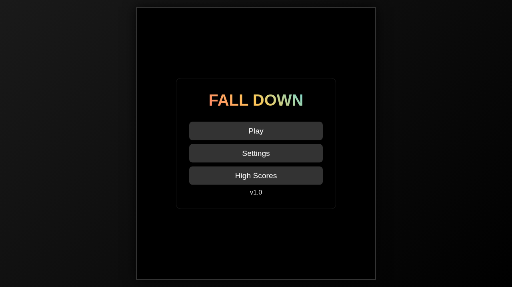

# F.O.N.G. Root Hub - Changelog

All notable changes to the root hub will be documented in this file.

## [Unreleased]
### Added
- **Installable app (PWA):** `manifest.webmanifest`, root `sw.js`, `offline.html`, `js/pwa.js` and controller icons in `assets/icons/`. The homepage shows an Install app button when the browser allows it (and an Add to Home Screen hint on iPhone). Pages opened once keep working offline. HTML is network first, other files stale while revalidate, one `CACHE_VERSION` constant, runtime cache capped at 150. Update toast with no auto reload. Kill switch `?pwa=off` (and `?pwa=on`). See `docs/PWA.md`.
- **Cheers and Slots K's Picks:** `js/cheer.js` (`FongCheer`) gives parent-controlled spoken cheers and captions, off by default, name stored only on the device. Wired into Slots, Memory Match and Nightlite Choir+. Slots v4.1.0 adds 6 K's Picks themes and a Sparkle Party Easter egg. See `docs/CHEER.md`.
- **Site navigation:** `games/cards/shared/card-nav.js` (`CardNav`) puts one strip with Home, Cards and the sibling games on every card game. `js/home-link.js` (`FongHome`) adds a small fixed Home pill to pages with no way back to the homepage, and Home links were added to about, daily, and the game, tool and tracing pages that lacked one. The Letter Tracing house button pointed at a missing `games/index.html` and now goes to the homepage. See `docs/NAVIGATION.md`.
- **Homepage theme engine (Phase 1):** Customize panel on the homepage with two skins (Classic, Print Shop), eight palettes plus Classic, per-color hex edits, shape and type controls, renaming, hide, pin, custom groups by catalog id, behaviors, and JSON export and import with a strict validator and a preview before applying. Recovery links `?theme=default` and `?safe=1`. Custom CSS and scripts are not supported yet. Added Space Grotesk (OFL) to `assets/fonts/`. See `docs/CUSTOMIZE.md`, `docs/CUSTOMIZE_IDS.md` and `docs/THEMING_SPEC.md`.
- **Homepage skins (Phase 2):** five more skins (Cabinet of Drawers, Control Panel, Metro Map, Handheld, Scrapbook), seven in all, each working with every palette. Font licenses in `LICENSE_AUDIT.md`, per-skin notes in `docs/skins/`.
- **Pink palettes and presets:** two new palettes (Bubblegum, Unicorn Dusk) and two importable themes in `docs/themes/` (K's board and K's night board).
- **Shared play stats:** `js/player-stats.js` (`FongStats`) keeps plays, last played and best score per catalog id, on-device only. Old `playcount_*` keys migrate once. See `docs/PLAYER_STATS.md`.

### Fixed
- **Phone fixes (360x640, 390x844, 844x390):** Input A11y v2 now loads `games/lib/StorageManager.js` (was `../../lib/`, a 404 that broke the page). Breakout QR script path fixed. SKYbreakers canvas sized by CSS so it no longer scrolls sideways at 2x. Snake clamps the food radius (no more IndexSizeError in landscape) and fits its controls bar. Sprunki Survival shows its placeholder without five 404s. Shared `negen/style.css` stops sideways scroll on all NEGEN pages (html overflow-x, border-box game headers). Flow canvas, Trace Letters header (was 419px wide) and the Tracing hub Back button overlap fixed.
- Header "Plays:" counter showed 0 (nothing wrote the counts it read). It now shows the real total, no 99 cap, large numbers as 1.2k.

### Removed
- Streak counters and flame from the Daily Command Center, and the `fong_streak_*` keys.

## [2.1.0] - 2026-02-15
### Added
- **Documentation Rollout:** Generated `README.md` and `AGENT.md` for 23 games across Priority 1, 2, and 3 tiers, completing the documentation requirement for the active game roster.
- **Storage Infrastructure:** Renamed `db/` to `storage/` to centralize persistence drivers.
- **Falldown Migration:** Updated the `Falldown` game to use the new `FongDB` storage engine (via `storage/`) for high scores and settings, replacing direct synchronous `localStorage` access.

### Verified
- **Falldown:** Game loads and displays the main menu successfully after storage engine migration.

## [2.0.0] - 2026-02-15
### Added
- Complete UI revamp utilizing the "Modern Dark Arcade" design system.
- `global.css` for standardized color tokens and typography.
- `card.css` for a mobile-first responsive grid.
- Dynamic mapping to the 18 Production-tier games identified in the `GAME_INVENTORY.md`.
- Strict Rule 10 documentation suite.

### Changed
- ⚠️ Removed all absolute pathing. Hub is now fully compliant with `/beta` branch deployments.
- ⚠️ Stripped all external CDN dependencies.

## [1.0.0] - Legacy
### Added
- Initial basic listing of F.O.N.G. games.
